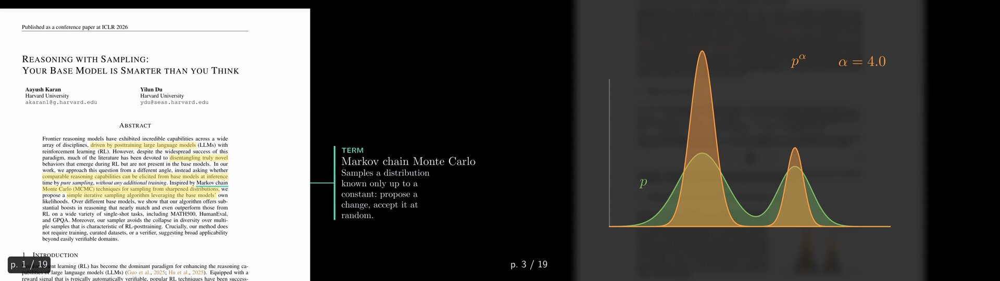

# video-kit

Paper PDF in, narrated walkthrough video out. Built for AI agents: one `video.py` per paper.

[](YOUTUBE_URL)

*Demo: [Reasoning with Sampling](https://proceedings.iclr.cc/paper_files/paper/2026/hash/01498f17142547dadb60999c39bd0a09-Abstract-Conference.html) (Karan & Du, ICLR 2026), written and built by an agent with this kit.*

```bash
./setup.sh                      # needs ffmpeg, espeak-ng, imagemagick, LaTeX, uv
bin/vk new paper.pdf            # then let your agent follow SKILL.md / BRIEF.md
bin/vk build videos/paper all -q h
```
